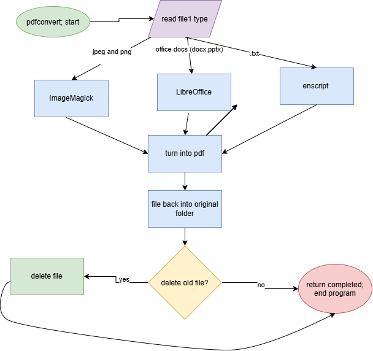

# topdfconverter193
This is a converter for different filetypes to pdf for cs193!

## The Problem
There have been so many times I wanted to quickly change different file formats into pdfs and to do it online becomes either very sketchy or expensive really quickly. Having something that can just be stored in a file on my computer, and run completely locally would be so helpful and probably a lot safer. 

## How It Works
This program reads the file type, then converts it to a pdf accordingly. Based on user input, it then decides to delete the original file or to keep both versions, then places the file back into the original folder.



## Tech Stack

- **Language:** Bash 
- **External tools:** LibreOffice, Weasyprint, enscript, pandoc.

## Setup

1. clone the repository and cd into the project
2. run the commands to download needed dependencies
3. you are ready!

```bash
git clone https://github.com/mbort207/topdfconverter193/
cd pdfconvert
./install.sh 
```

## Usage

How to actually run the thing, with examples.

```bash
pdfconvert ~/file.txt true 
```
will return the txt file as a pdf, deleting the old file.
```bash
pdfconvert ~/file.docx false 
```
will return the docx. file as a pdf, keeping the old file. (default).

## Roadmap

- [ ] Pdf back to other type.
- [ ] Allow markdown to pdf.
- [ ] Allow you to move it to a different folder when changing file type.

## Author

Michelle Bortey, https://github.com/mbort207
