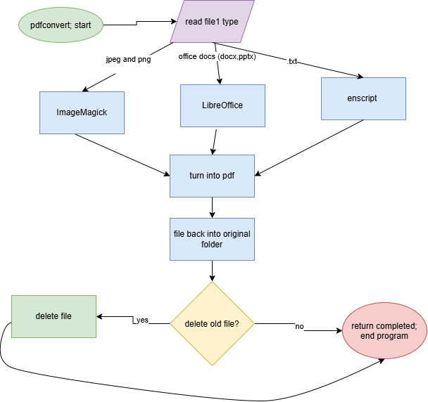

# topdfconverter193
This is a converter for different filetypes to pdf for cs193!

## The Problem
There have been so many times I wanted to quickly change different file formats into pdfs and to do it online becomes either very sketchy or expensive really quickly. Having something that can just be stored in a file on my computer, and run completely locally would be so helpful and probably a lot safer. 

## How It Works
This program reads the file type, then converts it to a pdf accordingly. Based on user input, it then decides to delete the original file or to keep both versions, then places the file back into the original folder.



## Tech Stack

- **Language:** Bash 
- **External tools:** LibreOffice, ImageMagick.

## Setup

1. clone the repository
```bash
git clone https://github.com/mbort207/topdfconverter193/
```
2. cd into the project (use pwd, cd, and ls to navigate)
```bash
cd topdfconverter193
```
3. run the commands to download needed dependencies
```bash
./install.sh
```
4. You are ready! Follow the usage below for best results!

## Usage

```bash
./pdfconvert ~/file.txt true 
```
will return the txt file as a pdf, deleting the old file.

Either
```bash
./pdfconvert ~/file.docx false 
```
or
```bash
./pdfconvert ~/file.docx
```
will return the file as a pdf, keeping the old file.


**Supported file types:**
- **Photos:** .png, .jpeg, .jpg
- **Office Documents:** .docx, .pptx, .xlsx
- **Other:** .txt
- ...all of these in uppercase and more to come!

## Roadmap

- [ ] Pdf back to other type.
- [ ] Allow markdown to pdf.
- [ ] Allow you to move it to a different folder when changing file type.
- [ ] Add numbering to pdfs with the same name

## Author

Michelle Bortey, https://github.com/mbort207
